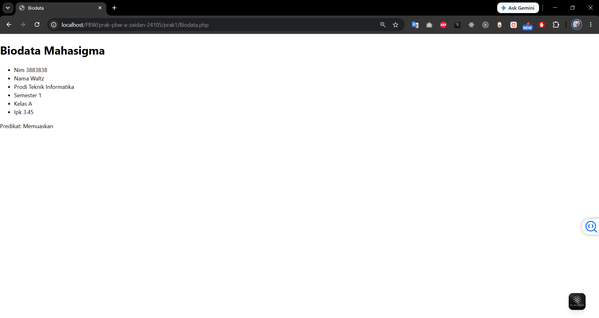
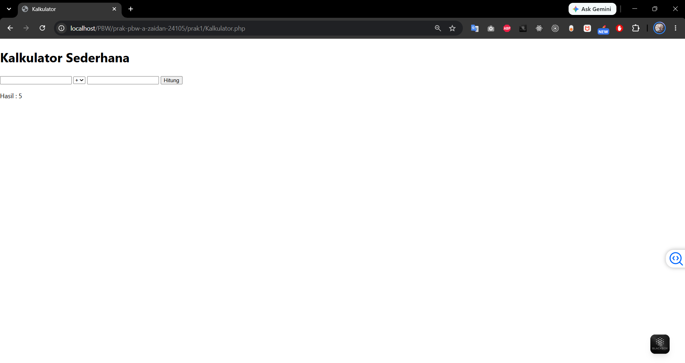

# 🧑‍💻 Praktikum 1 & 2 — Dasar-Dasar PHP

## 📌 Deskripsi
Praktikum ini membahas fundamental pemrograman PHP, mulai dari deklarasi variabel, penggunaan tipe data, operator, hingga struktur kontrol seperti percabangan dan perulangan. Seluruh file PHP dijalankan secara lokal menggunakan **Laragon**.

## 🛠️ Teknologi yang Digunakan
| Teknologi | Keterangan |
|-----------|------------|
| **PHP 8.x** | Bahasa pemrograman server-side |
| **Laragon** | Local development environment |
| **HTML** | Struktur halaman web |
| **Web Browser** | Menampilkan output PHP |

---

## 🧪 Latihan

### 📂 File: `latihan`
File ini merupakan latihan dasar PHP yang mencakup beberapa topik:

#### 1. Variabel & Tipe Data
Mendeklarasikan variabel `$nama`, `$umur`, `$hobi` (array), dan `$mahasiswa` (boolean) kemudian menampilkannya ke halaman.

#### 2. Perulangan (`for`, `while`)
- **Tabel Perkalian 5**: Menggunakan loop `for` untuk membuat tabel perkalian angka 5 dari 1 sampai 10.
- **Countdown**: Menggunakan loop `while` untuk menampilkan hitungan mundur 1 sampai 5.

#### 3. Percabangan (`if-else`)
Menampilkan status apakah pengguna merupakan mahasiswa aktif atau bukan berdasarkan variabel boolean.

#### 4. Array & `foreach`
Menampilkan daftar hobi menggunakan array dan perulangan `foreach` dalam bentuk list HTML.

---

## 📝 Tugas

### 🖩 Biodata.php
Halaman yang menampilkan biodata diri menggunakan variabel PHP yang di-render ke dalam tabel HTML.

**Data yang ditampilkan:**
- Nama, NIM, Jurusan, Prodi, Email
- Daftar hobi menggunakan array dan `foreach`

### ⚙️ Kalkulator.php
Kalkulator sederhana berbasis web yang menerima dua angka dan operator aritmatika melalui form HTML (method POST).

**Fitur:**
- Input dua bilangan
- Pilihan operator: `+`, `-`, `*`, `/`
- Validasi pembagian dengan nol
- Hasil perhitungan ditampilkan di bawah form

---

## 🚀 Cara Menjalankan
1. Pastikan **Laragon** sudah terinstal dan Apache aktif
2. Letakkan folder project di `C:\laragon\www\`
3. Buka browser, akses:
   - `http://localhost/PBW/prak-pbw-a-zaidan-24105/prak1/Biodata.php`
   - `http://localhost/PBW/prak-pbw-a-zaidan-24105/prak1/Kalkulator.php`
   - `http://localhost/PBW/prak-pbw-a-zaidan-24105/prak1/latihan`

## 📖 Apa yang Dipelajari
- Penulisan sintaks dasar PHP (`<?php ... ?>`)
- Penggunaan variabel, array, dan tipe data di PHP
- Percabangan menggunakan `if-else` dan `switch`
- Perulangan menggunakan `for`, `while`, dan `foreach`
- Menerima input dari form HTML dengan method POST
- Menggabungkan PHP dengan elemen HTML (tabel, list, form)
